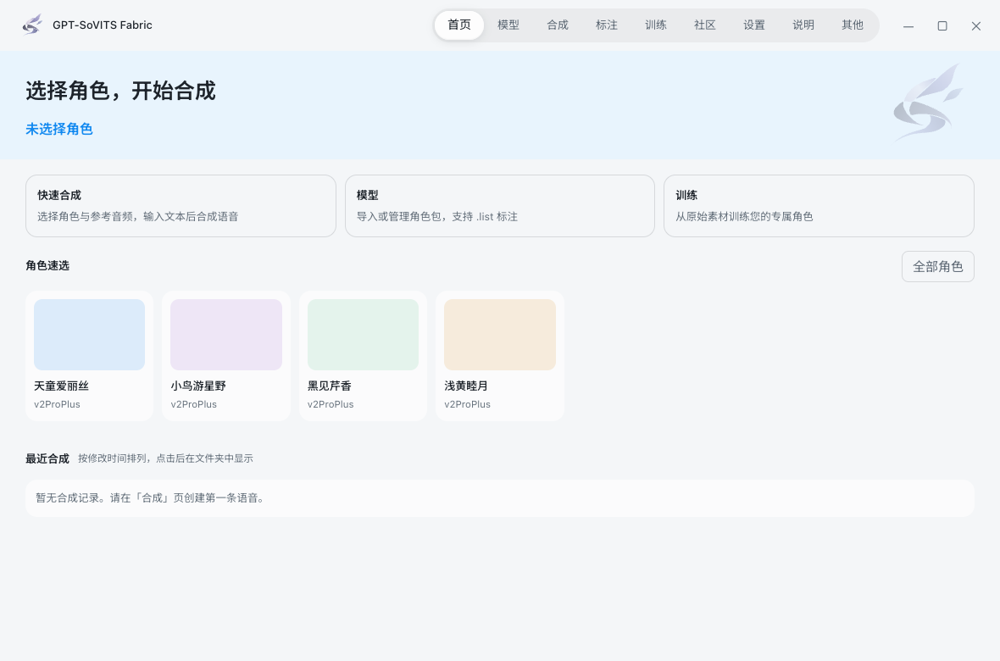

<div align="center">


# GPT-SoVITS Fabric

<!-- lang-nav -->
简体中文　·　[繁體中文](./docs/readme/README_zh-TW.md)　·　[English](./docs/readme/README_en.md)　·　[日本語](./docs/readme/README_ja.md)　·　[한국어](./docs/readme/README_ko.md)　·　[Español](./docs/readme/README_es.md)　·　[Français](./docs/readme/README_fr.md)　·　[Русский](./docs/readme/README_ru.md)
<!-- lang-nav -->

**Windows 语音合成与角色声音训练软件**

基于 [GPT-SoVITS](https://github.com/RVC-Boss/GPT-SoVITS) 开发，由 [图灵镜 Turing Mirror](https://github.com/Turing-Mirror) 维护。

[](./app/src-tauri/engine-payload/LICENSE)
[](https://github.com/RVC-Boss/GPT-SoVITS)

[GitHub 仓库](https://github.com/Turing-Mirror/GPT-SoVITS-Fabric) · [GitHub 发布页](https://github.com/Turing-Mirror/GPT-SoVITS-Fabric/releases)

**社媒**　[哔哩哔哩 @图灵镜](https://space.bilibili.com/3546871148579062)　·　[抖音 @图灵镜](https://v.douyin.com/6NxXcrKK9cc)（抖音号 `TuringMirror`）　·　[小红书 @图灵镜](https://www.xiaohongshu.com/user/profile/65f56bf1000000000b00e094)（小红书号 `TuringMirror`）　·　[YouTube @图灵镜](https://www.youtube.com/@TuringMirror)（YouTube 号 `@TuringMirror`）　·　QQ 群 @图灵镜社区（群号 `1077458748`）


</div>

---

## 界面截图




## 项目简介

GPT-SoVITS Fabric 是图灵镜基于 GPT-SoVITS 开发的免费开源 Windows 桌面软件，将文本转语音合成、角色声音管理、标注校对、人声分离与模型训练整合到一个独立客户端中。使用者无需自行配置 Python 环境或打开浏览器网页端，安装后即可在软件内按引导下载运行环境与基础模型并开始使用。

## 核心特性

- **语音合成**：支持单条与批量文本合成，可从角色关联的 `.list` 标注中选择 3 至 10 秒的参考音频，支持辅助参考融合、流式输出、按角色保存参数预设，以及导出 WAV 和 FLAC 音频。
- **推理引擎**：默认通过内嵌 Python 运行环境在 CUDA 或 CPU 上推理，支持 v1、v2、v2Pro、v2ProPlus、v3、v4、v5dev 与 v5turbo 角色；也可按需下载 Vulkan 资源，通过 [gsv.cpp](https://github.com/KakaruHayate/gsv.cpp) 在 Windows 上运行 v5turbo 的中文和日文合成。
- **角色库管理**：将 SoVITS 权重、GPT 权重、参考音频、`.list` 标注、封面图片与推荐参数作为角色包管理，支持导入、批量导出、资料编辑、封面裁剪与权重更换。
- **标注与素材处理**：内置 `.list` 标注编辑器，可在保存前检查缺失音频、空文本、重复条目和语种记号；集成人声分离、音频切分与自动转写工具，用于整理训练素材与合成参考。
- **模型训练**：提供从素材准备到 SoVITS 与 GPT 微调的完整流程，开放 v2、v2Pro、v2ProPlus、v4、v5dev 与 v5turbo 版本训练，并支持串行训练队列与中断后恢复。
- **社区与资源获取**：支持在社区页面浏览并下载角色包、引擎基础资源、各版本底模和人声分离模型，支持多线程下载与断点续传，并可登录图灵镜账号提交和更新角色投稿。
- **本机 API 与 MCP**：随包提供独立后台服务与 `gpt-sovits-fabric-mcp.exe`，可供本机程序或支持 MCP 的客户端查询角色并发起语音合成任务，详细说明见 [API v1](docs/api-v1.md)。

## 快速开始

1. 安装 GPT-SoVITS Fabric，首次启动后按新手引导下载运行环境（NVIDIA 显卡选择 CUDA 版，其余选择 CPU 版）与引擎基础资源。
2. 前往「社区」下载公开角色包，或在「模型」页导入本地角色包；如需训练自己的角色，可先在「训练」页准备素材并完成微调。
3. 打开「合成」，选择角色与对应的 3 至 10 秒参考音频，输入文本并选择推理引擎后开始合成。
4. 如需接入外部程序或模型上下文协议（MCP）客户端，可参考 [API v1](docs/api-v1.md) 配置 `gpt-sovits-fabric-mcp.exe` 或使用 `--headless` 启动后台服务。

## 技术架构与开发

### 架构

GPT-SoVITS Fabric 采用 **Tauri + Rust + React** 桌面外壳，推理与训练计算由后台进程承担。CUDA 推理、模型训练和人声分离通过内嵌 Python Worker 执行，Vulkan 推理通过本机 `gsv.cpp` 服务运行，桌面界面与本机 API 共用同一套任务流程和输出记录：

```text
GPT-SoVITS Fabric.exe (Tauri + Rust + React 桌面端与本机 API)
    ├─ CUDA / 训练 / 分离 ─> Runtime (Python 3.12 + PyTorch 2.7.1) + tools/*_worker.py
    └─ Vulkan 合成        ─> gsv_server.exe (gsv.cpp，支持 v5turbo)
```

上游 Gradio WebUI（`webui.py`）随包保留，需要时可在「其他」页启动。

### 环境要求与开发

**环境要求**：Windows 10/11 · Node.js 20+ · Rust Stable（`x86_64-pc-windows-msvc`）· Visual Studio C++ 构建工具与 WebView2 · Python 3.12+（构建脚本）

```powershell
# 1. 安装前端依赖并构建页面
cd app
npm ci
npm run build

# 2. 组装开发用产品根并启动桌面端（在 Visual Studio Developer PowerShell 中执行）
cd ..
python scripts/dev_root.py --pretrained <pretrained_models> --g2pw <G2PWModel>
$env:TM_VOICE_ROOT = (Resolve-Path data/dev-root).Path
cd app/src-tauri
cargo build --locked --bins -j 1
Copy-Item -Path ../frontend/* -Destination target/debug/frontend -Recurse -Force
./target/debug/gpt-sovits-fabric.exe --product-root $env:TM_VOICE_ROOT
```

仅预览前端页面可在 `app/` 下执行 `npm run dev`。详细构建步骤、依赖编译排错与设计约定见 [Windows 开发 v1](docs/development-v1.md) 和 [设计决策记录](docs/DECISIONS.md)。

### 构建与测试

- **前端单元测试与检查**：`cd app && npm test`、`npm run build`
- **Rust 单元测试**：`cd app/src-tauri && cargo test --locked --lib`
- **打包安装程序（NSIS）**：`python scripts/build_setup.py`（或 `cd app && npm run tauri:build`）
- **跟进上游源码**：`python scripts/prepare_engine_payload.py --upstream <上游仓> --runtime <Runtime>`
- **构建 Runtime**：`python scripts/build_runtime.py --variant nvidia`（或 `cpu`）
- **打包基础底模**：`python scripts/build_engine_core.py --pretrained <pretrained_models> --g2pw <G2PWModel>`
- **编译在线清单**：`python scripts/build_catalog.py --sources <发布仓>/catalog/sources.json --out <发布仓>/index.json --bundle app/src-tauri/engine-payload/configs/online_catalog.json`

> 可选：[局域网网页版预览](./lan_web/README.md)，独立构建，默认仅绑定本机。

## 开源许可与声音授权

- 本项目源码采用 [MIT License](./app/src-tauri/engine-payload/LICENSE) 许可协议开源。
- 模型权重、角色包及第三方资源遵循其原始许可协议。
- 使用他人声音进行训练或语音合成前，请取得声音权利人的授权，并遵守当地法律法规。

## 致谢

感谢以下开源项目为 GPT-SoVITS Fabric 提供的技术支持：

- [GPT-SoVITS](https://github.com/RVC-Boss/GPT-SoVITS) — 核心声学模型与上游基础
- [gsv.cpp](https://github.com/KakaruHayate/gsv.cpp) — Vulkan 推理引擎支持
- [RVC Fabric](https://github.com/Turing-Mirror/RVC-Fabric) — 桌面端架构与界面基础
- [PyMSS](https://github.com/RVC-Project/Retrieval-based-Voice-Conversion-WebUI) · [Ultimate Vocal Remover](https://github.com/Anjok07/ultimatevocalremovergui) — 人声分离引擎与模型来源
- [FFmpeg](https://github.com/FFmpeg/FFmpeg) · [audio-slicer](https://github.com/openvpi/audio-slicer) — 音频处理与切分
