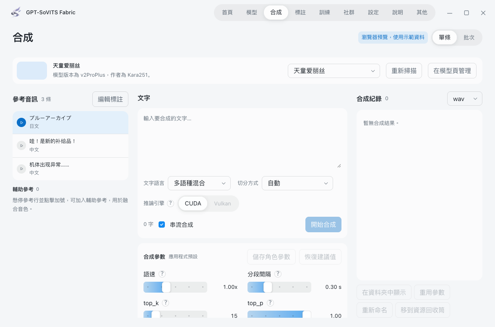

<div align="center">


# GPT-SoVITS Fabric

<!-- lang-nav -->
[简体中文](./README.md)　·　[繁體中文](./README_zh-TW.md)　·　[English](./README_en.md)　·　[日本語](./README_ja.md)　·　[한국어](./README_ko.md)　·　[Español](./README_es.md)　·　Français　·　[Русский](./README_ru.md)
<!-- lang-nav -->

**Logiciel de synthèse vocale et d'entraînement de voix de personnages pour Windows**

Basé sur [GPT-SoVITS](https://github.com/RVC-Boss/GPT-SoVITS) et maintenu par [Turing Mirror](https://github.com/Turing-Mirror).

[](./app/src-tauri/engine-payload/LICENSE)
[](https://github.com/RVC-Boss/GPT-SoVITS)

[Dépôt GitHub](https://github.com/Turing-Mirror/GPT-SoVITS-Fabric) · [Téléchargement CNB](https://cnb.cool/Turing-Mirror/GPT-SoVITS-Fabric-Releases)

**Réseaux sociaux**　[Bilibili @Turing Mirror](https://space.bilibili.com/3546871148579062)　·　[Douyin @Turing Mirror](https://v.douyin.com/6NxXcrKK9cc) (ID Douyin `TuringMirror`)　·　[Xiaohongshu @Turing Mirror](https://www.xiaohongshu.com/user/profile/65f56bf1000000000b00e094) (ID Xiaohongshu `TuringMirror`)　·　[YouTube @Turing Mirror](https://www.youtube.com/@TuringMirror) (identifiant YouTube `@TuringMirror`)　·　Groupe QQ @Communauté Turing Mirror (N° de groupe `1077458748`)


</div>

---

## Captures d’écran




## Introduction du projet

GPT-SoVITS Fabric est une application Windows gratuite et open source développée par Turing Mirror à partir de GPT-SoVITS. Elle réunit la synthèse vocale à partir de texte, la gestion de voix de personnages, l'édition d'annotations `.list`, la séparation vocale et l'entraînement de modèles dans un client autonome. Il n'est pas nécessaire d'installer Python manuellement ni d'ouvrir une interface web dans un navigateur : après l'installation, l'assistant initial télécharge l'environnement d'exécution et les modèles de base nécessaires.

## Fonctionnalités principales

- **Synthèse vocale** : Prend en charge la synthèse de texte unique ou par lots, la sélection d'audios de référence de 3 à 10 secondes depuis les annotations `.list` associées au personnage, le mélange avec des références auxiliaires, le streaming, l'enregistrement de paramètres par personnage ainsi que l'export en WAV et FLAC.
- **Moteurs d'inférence** : Exécute par défaut l'inférence sur CUDA ou CPU via l'environnement Python intégré pour les personnages `v1`, `v2`, `v2Pro`, `v2ProPlus`, `v3`, `v4`, `v5dev` et `v5turbo`. Permet également de télécharger les ressources Vulkan optionnelles afin d'exécuter la synthèse en chinois et en japonais sur `v5turbo` sous Windows avec [gsv.cpp](https://github.com/KakaruHayate/gsv.cpp).
- **Gestion des personnages** : Regroupe les poids SoVITS et GPT, les audios de référence, les annotations `.list`, la couverture et les paramètres recommandés en packs de personnages, avec importation, exportation par lots, édition des métadonnées, recadrage de couverture et remplacement des poids.
- **Annotations et préparation des données** : Intègre un éditeur `.list` qui vérifie avant l'enregistrement les fichiers audio manquants, textes vides, doublons et codes de langue ; fournit également des outils de séparation vocale, de découpage audio et de transcription automatique.
- **Entraînement de modèles** : Couvre la préparation des données et l'affinage SoVITS et GPT pour les versions `v2`, `v2Pro`, `v2ProPlus`, `v4`, `v5dev` et `v5turbo`, avec file d'entraînement séquentielle et reprise après interruption.
- **Communauté et ressources** : Permet de parcourir et de télécharger des packs de personnages, des ressources de base du moteur, des modèles pré-entraînés par version et des modèles de séparation vocale avec téléchargement multiconnexion et reprise ; la connexion avec un compte Turing Mirror permet de soumettre et mettre à jour des publications de personnages.
- **API locale et MCP** : Fournit un service local autonome et `gpt-sovits-fabric-mcp.exe` afin que des applications locales ou des clients MCP puissent lister les personnages et lancer des synthèses. Voir [API v1](docs/api-v1.md).

## Démarrage rapide

1. Installez GPT-SoVITS Fabric et suivez l'assistant de premier lancement pour télécharger l'environnement d'exécution (choisissez CUDA pour un GPU NVIDIA, sinon CPU) ainsi que les ressources de base du moteur.
2. Ouvrez **Communauté** pour télécharger un pack de personnage public ou importez un pack local dans **Modèles** ; pour créer votre propre voix, préparez les données et lancez l'entraînement dans **Entraîner**.
3. Ouvrez **Synthèse**, sélectionnez un personnage et un audio de référence de 3 à 10 secondes, saisissez le texte, choisissez le moteur d'inférence et lancez la synthèse.
4. Pour l'intégrer à un outil externe ou à un client MCP, consultez [API v1](docs/api-v1.md) afin de configurer `gpt-sovits-fabric-mcp.exe` ou de démarrer le service avec `--headless`.

## Architecture technique et développement

### Architecture

GPT-SoVITS Fabric repose sur un shell de bureau **Tauri + Rust + React**, tandis que l'inférence et l'entraînement sont exécutés par des processus en arrière-plan. L'inférence CUDA, l'entraînement et la séparation vocale passent par des workers Python intégrés, et la synthèse Vulkan s'appuie sur un serveur local `gsv.cpp`. L'interface de bureau et l'API locale partagent le même flux de tâches et l'historique des sorties :

```text
GPT-SoVITS Fabric.exe (application de bureau Tauri + Rust + React et API locale)
    ├─ CUDA / Entraînement / Séparation ─> Runtime (Python 3.12 + PyTorch 2.7.1) + tools/*_worker.py
    └─ Synthèse Vulkan                  ─> gsv_server.exe (gsv.cpp pour v5turbo)
```

L'interface web Gradio en amont (`webui.py`) est conservée dans le paquet et peut être ouverte depuis la page **Plus**.

### Prérequis et développement

**Prérequis** : Windows 10/11 · Node.js 20+ · Rust Stable (`x86_64-pc-windows-msvc`) · Outils de build C++ Visual Studio et WebView2 · Python 3.12+ (scripts de build)

```powershell
# 1. Installer les dépendances frontend et compiler l'interface
cd app
npm ci
npm run build

# 2. Assembler la racine de développement et lancer l'application (dans Visual Studio Developer PowerShell)
cd ..
python scripts/dev_root.py --pretrained <pretrained_models> --g2pw <G2PWModel>
$env:TM_VOICE_ROOT = (Resolve-Path data/dev-root).Path
cd app/src-tauri
cargo build --locked --bins -j 1
Copy-Item -Path ../frontend/* -Destination target/debug/frontend -Recurse -Force
./target/debug/gpt-sovits-fabric.exe --product-root $env:TM_VOICE_ROOT
```

Pour prévisualiser uniquement l'interface dans le navigateur, exécutez `npm run dev` dans `app/`. Consultez [Développement Windows v1](docs/development-v1.md) et [Journal des décisions](docs/DECISIONS.md) pour la procédure complète, le dépannage et les choix d'architecture.

### Build et tests

- **Tests et build frontend** : `cd app && npm test`, `npm run build`
- **Tests unitaires Rust** : `cd app/src-tauri && cargo test --locked --lib`
- **Créer l'installeur (NSIS)** : `python scripts/build_setup.py` (ou `cd app && npm run tauri:build`)
- **Synchroniser la source amont** : `python scripts/prepare_engine_payload.py --upstream <dépôt-amont> --runtime <Runtime>`
- **Construire le Runtime** : `python scripts/build_runtime.py --variant nvidia` (ou `cpu`)
- **Construire les paquets de modèles de base** : `python scripts/build_engine_core.py --pretrained <pretrained_models> --g2pw <G2PWModel>`
- **Compiler le catalogue en ligne** : `python scripts/build_catalog.py --sources <dépôt-releases>/catalog/sources.json --out <dépôt-releases>/index.json --bundle app/src-tauri/engine-payload/configs/online_catalog.json`

## Licence et autorisation d'utilisation des voix

- Le code source de ce projet est distribué sous [Licence MIT](./app/src-tauri/engine-payload/LICENSE).
- Les poids des modèles, packs de personnages et ressources tierces restent soumis à leurs licences d'origine.
- Obtenez l'autorisation du titulaire des droits avant d'utiliser la voix d'autrui pour l'entraînement ou la synthèse vocale, et respectez la législation locale applicable.

## Remerciements

Merci aux projets open source suivants pour leur contribution technique à GPT-SoVITS Fabric :

- [GPT-SoVITS](https://github.com/RVC-Boss/GPT-SoVITS) — Modèles acoustiques principaux et base amont
- [gsv.cpp](https://github.com/KakaruHayate/gsv.cpp) — Prise en charge du moteur d'inférence Vulkan
- [RVC Fabric](https://github.com/Turing-Mirror/RVC-Fabric) — Architecture bureautique et base d'interface
- [PyMSS](https://github.com/RVC-Project/Retrieval-based-Voice-Conversion-WebUI) · [Ultimate Vocal Remover](https://github.com/Anjok07/ultimatevocalremovergui) — Moteur de séparation vocale et source des modèles
- [FFmpeg](https://github.com/FFmpeg/FFmpeg) · [audio-slicer](https://github.com/openvpi/audio-slicer) — Traitement et découpage audio
